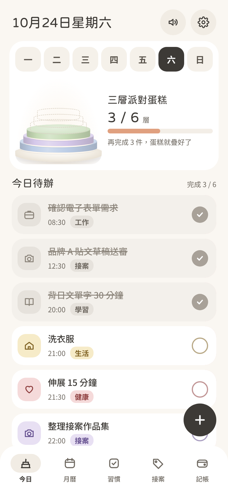
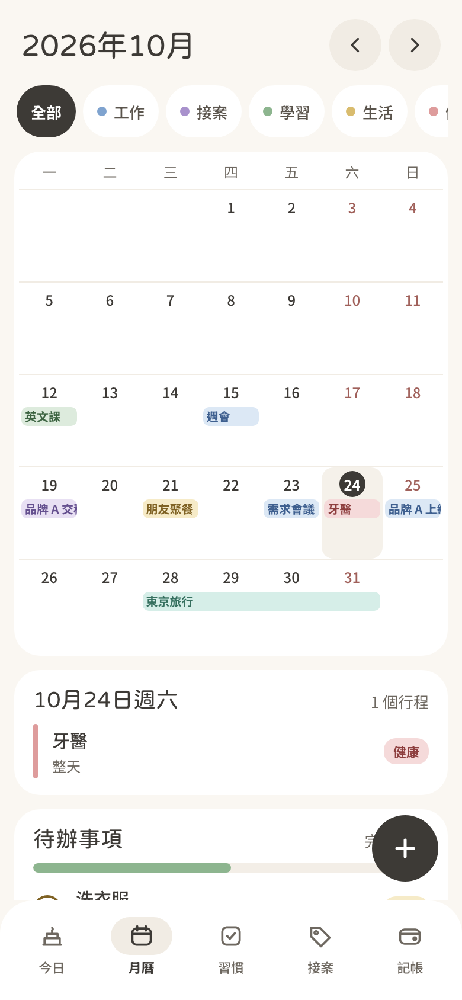
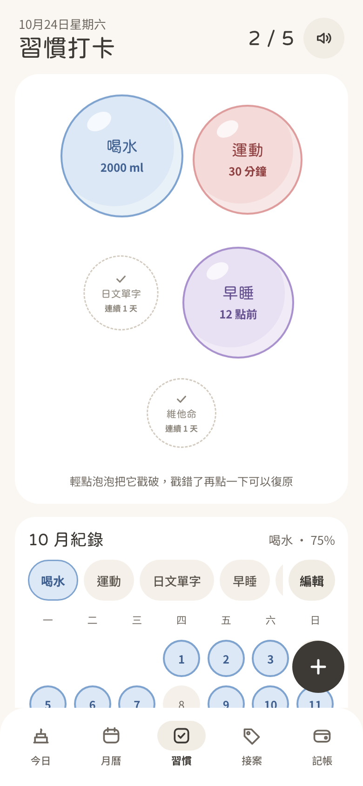
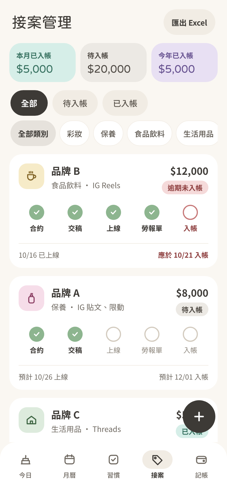
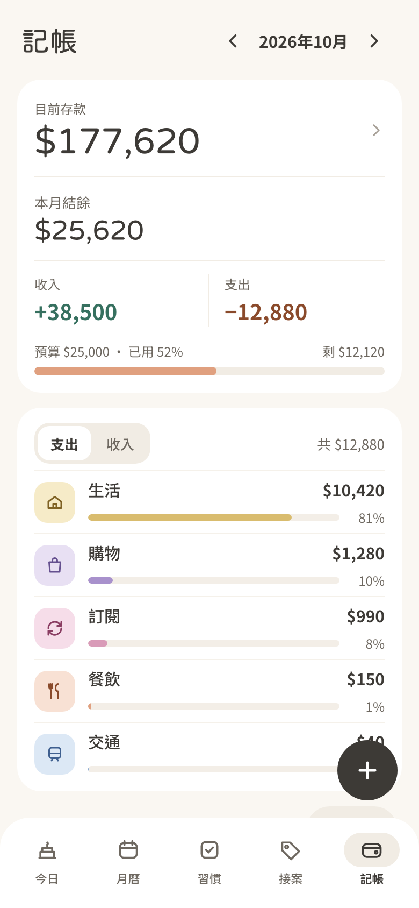
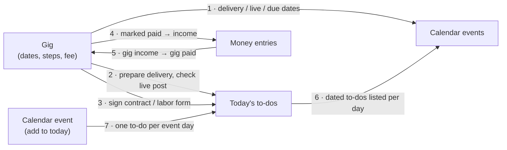
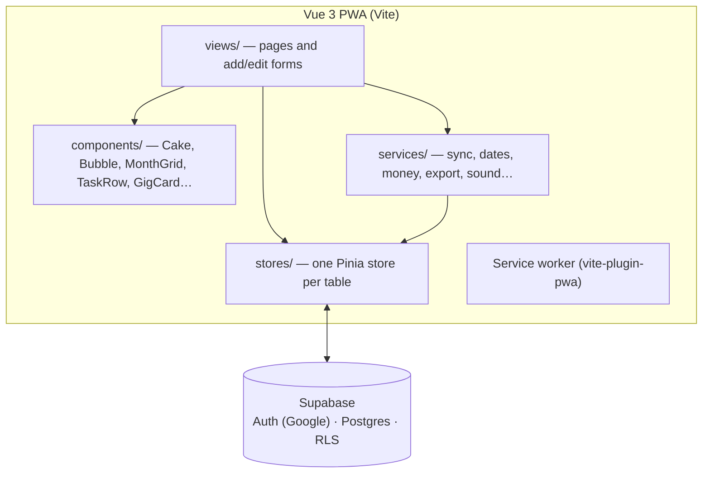

# Planner

A personal life planner for one person: daily to-dos, a month calendar, habit tracking, freelance gig management and money tracking — in one installable, mobile-first web app.

The twist: **every to-do you finish stacks a layer onto the day's dessert** (a different one each weekday), habits are checked off by **popping bubbles**, and **gig dates, to-dos and income sync themselves** across the calendar, to-do list and money book.

Traditional Chinese and English, switchable in Settings.

| Today | Calendar | Habits | Gigs | Money |
| --- | --- | --- | --- | --- |
|  |  |  |  |  |

## Features

**Today**
- To-dos for the day; tick one and a layer in that category's color drops onto the cake with a water-bubble sound. Finish them all and toppings appear with a fairy-glitter chime.
- Ten desserts (strawberry shortcake, mille crêpe, cupcake, sundae, pudding, pancake stack, party tier cake, tiramisu, strawberry tart, cream roll), one per weekday or a random set each week.
- Layer math: one layer per to-do up to the daily limit (6–12), then layers merge by category.
- Repeating to-dos (daily, weekly, monthly); swipe left to edit or delete.

**Calendar**
- Month grid with multi-day events drawn as continuous bars (kept in the same lane across a week).
- Filter by category across events and to-dos; tap a day to see its events and to-dos.

**Habits**
- Each habit is a floating bubble on the days it's scheduled; tap to pop (ring + droplets + sound), tap again to undo.
- Monthly record per habit with current and best streaks (unscheduled days don't break a streak).

**Gigs** (brand collaborations)
- Cards with five steps in order — contract → delivery → live → labor form → paid — that tick and untick together.
- Paid / unpaid / overdue status, totals for the month and year, filters by payment status and product category.

**Money**
- Monthly balance, income vs. spending, budget bar, spending ranked by category, entries grouped by day with type and category filters.
- Optional running savings total, budgets per category, a month that can start on payday.
- Excel / CSV export of gig income and money entries (for taxes).

**Everything** can be added, edited and deleted. Settings cover language, week start, categories and colors, desserts, budget, sync switches and a JSON backup download.

## How the modules sync

All cross-module rules live in [`src/services/sync.ts`](src/services/sync.ts); pages only call it. Every rule is idempotent and has unit tests.



| # | Rule | Switch |
| --- | --- | --- |
| 1 | A gig's delivery, live and payment dates become calendar events (colored by kind) | Settings + per gig |
| 2 | "Prepare delivery" the day before, "Check the post is live" on the live day | per gig |
| 3 | One "Sign contract / labor form" to-do, done once both are signed | per gig |
| 4 | Marking a gig paid records the income; marking it unpaid removes it | Settings + per gig |
| 5 | An income entry filed under a gig marks that gig paid | — |
| 6 | Dated to-dos appear in the calendar's day view (queried, not copied) | per to-do |
| 7 | An event with "also add to today" creates a to-do for each of its days | per event |
| 8 | Habits stay on the Habits page | — |
| 9 | Unfinished one-off to-dos move to today on the first open of the day | Settings |

Generated rows carry `source = 'gig' | 'event'`, follow their source when it changes and are removed with it; anything the user made by hand is left alone.

## Architecture



- **Vue 3** (`<script setup>`) + **TypeScript** + **Vite**, **Vue Router**, **Pinia**, **vue-i18n**
- **Supabase**: Google sign-in, Postgres, Row Level Security (each user only ever reads and writes their own rows)
- **vite-plugin-pwa**: installable from Safari's "Add to Home Screen", app shell and sounds cached for offline use
- **Web Audio API** for sounds, **SheetJS** for Excel export (loaded only when exporting)
- **Vitest** for unit tests — sync rules, cake layer math, streaks, repeats, budget periods, export
- No UI component library; flat pastel design in [`src/styles/tokens.css`](src/styles/tokens.css). Only the cake uses gradients and shadows.

```
src/
  views/            Today, Calendar, Habits, Gigs, Money, Settings, Login
  views/add/        add/edit forms (task, event, habit, gig, money)
  views/settings/   categories, cakes, budget, savings, export, backup
  components/       BottomNav, Fab, Toggle, TaskRow, GigCard, MonthGrid, NumberPad, …
  components/cake/  Cake.vue, desserts.ts (shapes), layers.ts (layer math)
  stores/           settings, categories, tasks, events, habits, gigs, money
  services/         supabase, session, sync, dates, repeat, habits, money, export, sound, backup
  locales/          zh-TW.json, en.json
supabase/schema.sql database, indexes and RLS policies
docs/               SPEC.md (spec), DECISIONS.md (decisions that override it), screenshots
```

## Running it locally

Requires Node 22.18+ or 24.12+.

1. **Supabase**: create a project, open **SQL Editor** and run [`supabase/schema.sql`](supabase/schema.sql) (safe to re-run).
2. **Google sign-in**: in Google Cloud create an OAuth client (Web application) with
   - authorized JavaScript origin `http://localhost:5173`
   - authorized redirect URI `https://<project-ref>.supabase.co/auth/v1/callback`

   then enable **Authentication → Sign In / Providers → Google** in Supabase with its client ID and secret, and set **Authentication → URL Configuration** Site URL and Redirect URLs to `http://localhost:5173`.
3. **Environment**: copy `.env.example` to `.env.local` and fill in the project URL and the publishable (anon) key. `.env.local` is git-ignored.
4. Install and run:

```sh
npm install
npm run dev        # http://localhost:5173
npm run test:unit  # Vitest (watch mode); `npx vitest run` for a single run
npm run build      # type-check + production build
npm run lint
```

## Deploying to Vercel

1. Push the repository to GitHub and import it in Vercel. The framework preset is detected from [`vercel.json`](vercel.json) (Vite, `npm run build`, output `dist`, SPA rewrites).
2. In **Project Settings → Environment Variables** add `VITE_SUPABASE_URL` and `VITE_SUPABASE_ANON_KEY`, then deploy.
3. Add the production URL (e.g. `https://planner-xyz.vercel.app`):
   - Supabase **URL Configuration**: Site URL and Redirect URLs
   - Google OAuth client: authorized JavaScript origins
4. On an iPhone, open the URL in Safari → Share → **Add to Home Screen**.

## Project docs

- [`docs/SPEC.md`](docs/SPEC.md) — the full product spec (in Traditional Chinese)
- [`docs/DECISIONS.md`](docs/DECISIONS.md) — decisions made during development, which take precedence over the spec
